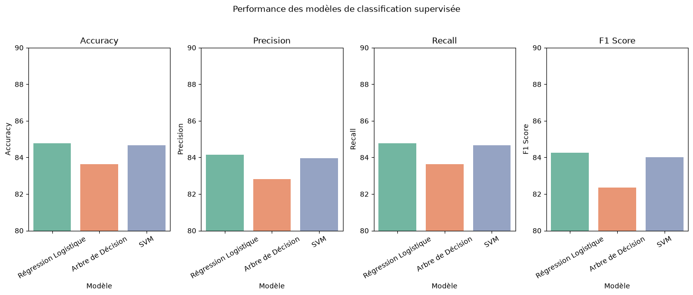
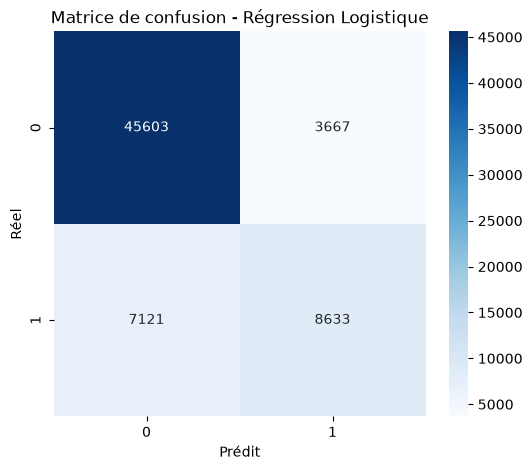
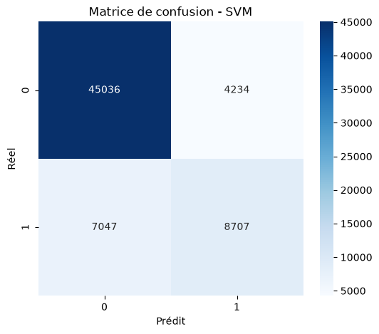
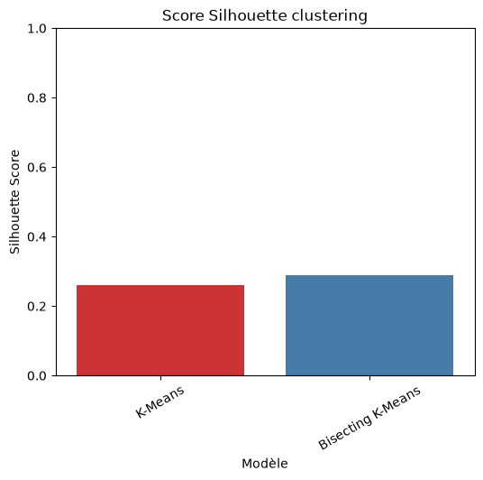
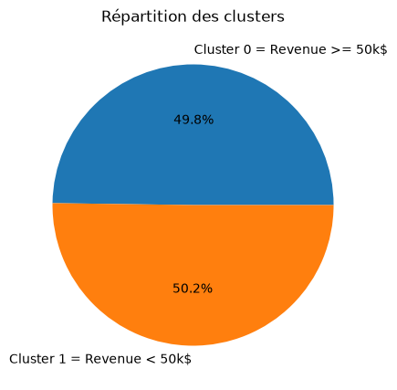
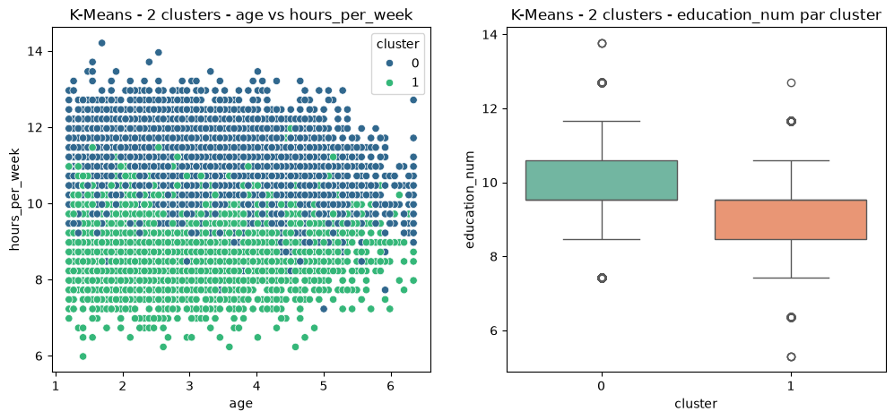
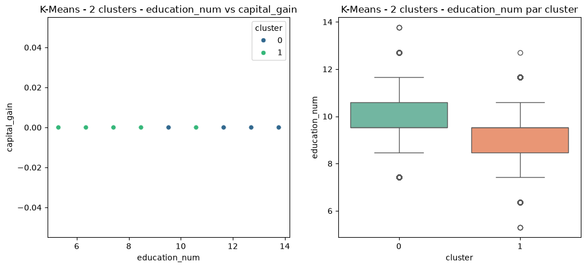
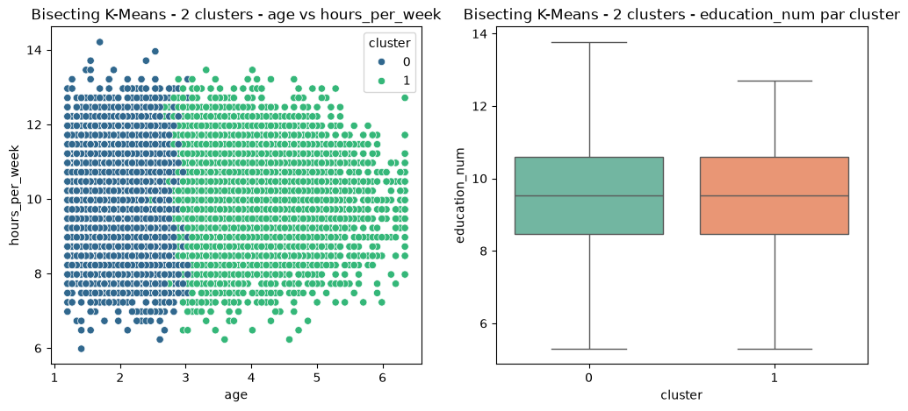
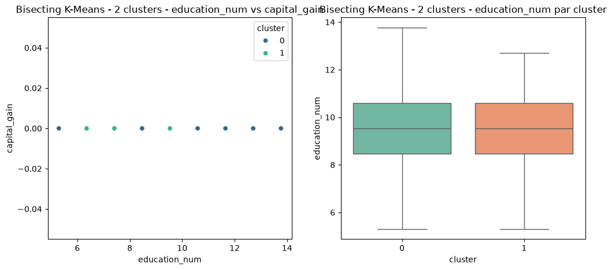

# Classification et clustering avec PySpark et MLlib

Classification supervisée et clustering non supervisé à grande échelle avec PySpark et MLlib, appliqués au dataset Adult Census Income (UCI) pour prédire le niveau de revenu des individus.

## Contexte et objectif

Dans un monde de plus en plus dominé par les données, l'analyse et l'extraction de connaissances à partir de vastes ensembles de données sont devenues essentielles pour la prise de décision. Ce projet exploite **PySpark** et **MLlib**, outils de référence pour le Machine Learning distribué, afin de réaliser des tâches de classification supervisée et de clustering non supervisé sur un jeu de données volumineux.

L'objectif est de mettre en œuvre des algorithmes de Machine Learning à grande échelle sur le dataset **Adult Census Income** de l'UCI, qui recense des informations socio-économiques permettant de prédire si le revenu d'un individu dépasse 50 000 $ par an.

## Dataset

- **Source** : [Adult Census Income (UCI Machine Learning Repository)](https://archive.ics.uci.edu/ml/machine-learning-databases/adult/)
- **Volume original** : environ 32 000 lignes, 15 colonnes (âge, niveau d'éducation, statut marital, profession, revenu, etc.)
- **Génération de données synthétiques** : pour simuler un contexte Big Data, le dataset a été augmenté à l'aide de la librairie Faker (variation statistique contrôlée autour des valeurs réelles), produisant un jeu final de **325 610 lignes**, tout en conservant les distributions et relations du dataset d'origine.

## Méthodologie

1. **Nettoyage des données** : suppression des valeurs manquantes (`?` remplacés par `None`), harmonisation du format de la variable cible entre les fichiers train/test.
2. **Génération de données à grande échelle** : augmentation du dataset via Faker avec seeds fixes pour la reproductibilité.
3. **Feature engineering** : indexation des variables catégorielles (`StringIndexer`), encodage one-hot (`OneHotEncoder`), assemblage des features (`VectorAssembler`), standardisation (`StandardScaler`), le tout orchestré via des `Pipeline` MLlib.
4. **Classification supervisée** : entraînement et évaluation de trois modèles — Régression Logistique, Arbre de Décision, SVM linéaire — sur la prédiction du niveau de revenu.
5. **Clustering non supervisé** : segmentation des individus avec K-Means et Bisecting K-Means (k=2), évaluée par score de silhouette.

## Technologies utilisées

- **PySpark** : traitement distribué des données
- **MLlib** : algorithmes de Machine Learning à grande échelle (classification, clustering, pipelines)
- **Python** : Faker (génération de données), Pandas, Matplotlib, Seaborn (analyse et visualisation), scikit-learn (matrices de confusion, rapports de classification)

## Résultats

### Classification supervisée

| Modèle | Accuracy | Precision | Recall | F1 Score |
|---|---|---|---|---|
| Régression Logistique | 83.41% | 82.50% | 83.40% | 82.67% |
| Arbre de Décision | 82.48% | 81.40% | 82.50% | 81.30% |
| SVM (linéaire) | 82.65% | 81.80% | 82.70% | 82.04% |

La régression logistique obtient les meilleurs résultats, suivie de près par le SVM.

Les métriques peuvent varier légèrement selon l'environnement d'exécution : le seed fixé pour la génération des données (Faker) ne couvre pas le hasard interne des algorithmes MLlib ni la recombinaison distribuée des calculs par Spark, qui dépend des ressources (cores, mémoire) disponibles.








### Clustering non supervisé

| Algorithme | Score de silhouette |
|---|---|
| K-Means | 0.259 |
| Bisecting K-Means | 0.289 |

Bisecting K-Means produit une segmentation légèrement plus cohérente que K-Means classique sur ce jeu de données.




*Répartition des individus entre les deux clusters K-Means (revenu ≥ 50k$ vs < 50k$).*


*K-Means — âge vs heures travaillées par semaine, et niveau d'éducation par cluster.*


*K-Means — niveau d'éducation vs capital_gain par cluster.*


*Bisecting K-Means — âge vs heures travaillées par semaine, et niveau d'éducation par cluster.*


*Bisecting K-Means — niveau d'éducation vs capital_gain par cluster.*

## Analyse

Les individus ayant un niveau d'éducation élevé et un nombre d'heures travaillées élevé sont plus représentés dans le cluster correspondant aux revenus supérieurs ou égaux à 50 000 $. Sur les données réelles, cette tendance s'accompagne également d'un capital_gain plus élevé, confirmant la cohérence entre les résultats de classification et de clustering.

## Perspectives d'amélioration

- Tuning d'hyperparamètres via `CrossValidator`
- Intégration de modèles plus complexes (Random Forest, Gradient-Boosted Trees)
- Déploiement sur un cluster Spark dédié pour traiter des volumes encore plus importants

## Installation et exécution

```bash
pip install -r requirements.txt
python main.py
```

Le script télécharge automatiquement le dataset depuis l'UCI Machine Learning Repository, exécute le pipeline complet (nettoyage, génération de données, feature engineering, classification, clustering) et sauvegarde les visualisations dans `reports/figures/`.

## Auteurs

Projet réalisé dans le cadre du cours de Big Data (DIC2, École Polytechnique de Thiès, 2024-2025), encadré par le Pr I. Gueye.

- Touba CISSE
- Ngoné NDIAYE
